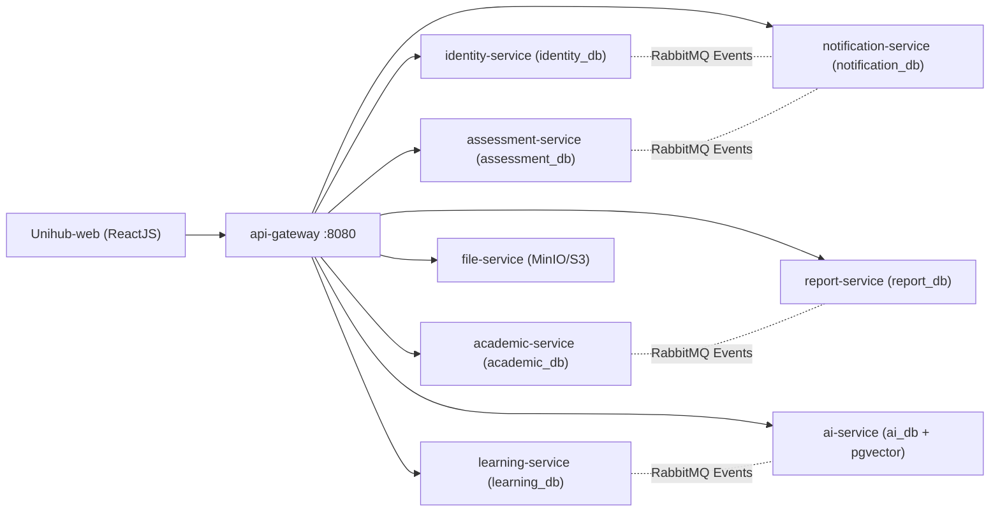

# Kiến trúc Microservice - Unihub

## 1. Tổng quan & Ranh giới Service

Unihub sử dụng kiến trúc **Microservices (Spring Boot 3, Java 21)** theo mô hình **Database per Service** (mỗi service sở hữu một database riêng trên cùng instance PostgreSQL `pgvector`, tuyệt đối không join chéo DB).

| Service | Port | Database | Trách nhiệm chính |
|---|---|---|---|
| `api-gateway` | `8080` | - (Redis rate-limit) | Định tuyến, xác thực JWT, CORS, rate limit, gộp Swagger UI |
| `identity-service` | `8081` | `identity_db` | Đăng nhập JWT, refresh token, RBAC (Admin/Lecturer/Student), CRUD user, import user, audit log |
| `academic-service` | `8082` | `academic_db` | Khoa, ngành, lớp hành chính, học kỳ, môn học, lớp học phần, đăng ký học phần, thời khóa biểu |
| `learning-service` | `8083` | `learning_db` | Chương/bài học, tài liệu, video, tiến độ học, bài tập & nộp bài, hỏi đáp bài học |
| `assessment-service` | `8084` | `assessment_db` | Ngân hàng câu hỏi, quiz/đề thi, điểm thành phần, bảng điểm & GPA, điểm danh |
| `notification-service` | `8085` | `notification_db` | Thông báo in-app, thông báo lớp, gửi email nền (MailHog/SMTP) |
| `report-service` | `8086` | `report_db` | Dashboard theo vai trò, cảnh báo học vụ (lưu read-model từ sự kiện) |
| `ai-service` | `8087` | `ai_db` (`pgvector`) | Trích xuất tài liệu (Tika), embedding & RAG chat (Google Gemini API), sinh quiz/flashcard |
| `file-service` | `8088` | - (MinIO/S3) | Quản lý bucket, cấp presigned URL upload/download, dọn tệp mồ côi |

## 2. Quy ước giao tiếp giữa các service

1. **Tham chiếu chéo bằng ID:** Service A chỉ lưu `userId`, `courseSectionId`, `fileId`... (không lưu khóa ngoại DB sang service khác).
2. **Giao tiếp đồng bộ (REST via OpenFeign + Resilience4j):** Dùng khi cần dữ liệu tức thời (ví dụ `academic-service` lấy thông tin sinh viên từ `identity-service`), luôn truyền JWT + `X-Correlation-Id`.
3. **Giao tiếp bất đồng bộ (RabbitMQ Events):** Dùng cho thông báo, đồng bộ read-model (`report-service`), và re-index tài liệu AI (`ai-service`). Mọi consumer phải đảm bảo **idempotency**.
